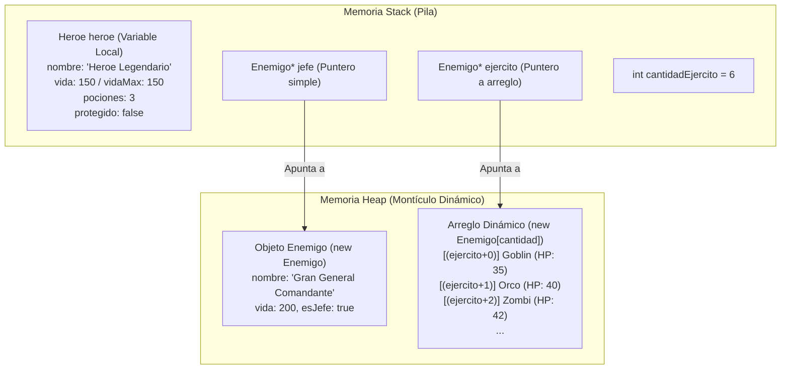
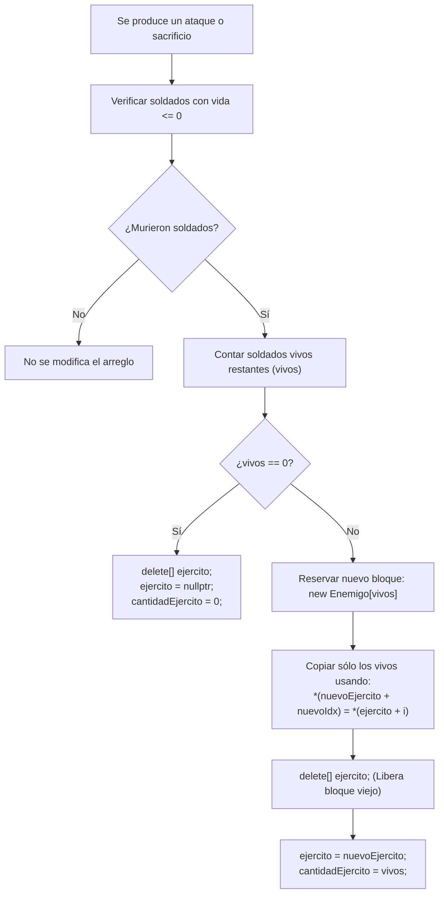
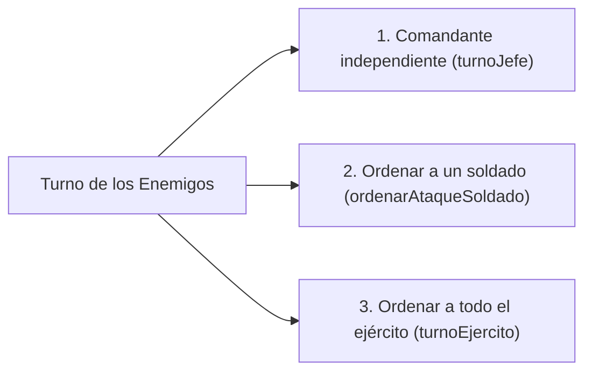

# Guía de Explicación y Sustentación: La Batalla Final por el Reino

Este documento contiene la explicación técnica y conceptual del proyecto de simulación de combate por turnos en **C++**, preparado para responder a cualquier pregunta o sustentación con el profesor.

---

## 1. Arquitectura y Gestión de Memoria

El proyecto pone en práctica la diferencia fundamental entre los dos segmentos principales de memoria: **Stack (Pila)** y **Heap (Montículo)**.



### ¿Por qué cada entidad está en su respectiva memoria?
1. **El Héroe en el Stack**:
   - Se declara como variable local en `main`: `Heroe heroe = {"Heroe Legendario", 150, 150, 3, false};`.
   - Su ciclo de vida está ligado al ámbito (*scope*) de `main`. Se reserva y libera de forma automática sin necesidad de gestión manual.
2. **El Comandante en el Heap**:
   - Se crea dinámicamente con asignación simple: `Enemigo* jefe = new Enemigo;` mediante la función `crearJefe(...)`.
   - Retorna un puntero `Enemigo*` que referencia el bloque en el Heap.
3. **El Ejército en el Heap**:
   - Se crea como arreglo dinámico contiguo: `Enemigo* ejercito = new Enemigo[cantidad];` en `crearEjercito(...)`.
   - Permite que el tamaño del ejército sea variable y adaptable.

### Liberación de Memoria y Punteros Colgados (Dangling Pointers)
Al finalizar la partida, se debe liberar explícitamente todo bloque reservado en el Heap:
```cpp
if (jefe != nullptr) {
    delete jefe;      // Libera objeto individual
    jefe = nullptr;   // Evita puntero colgante
}

if (ejercito != nullptr) {
    delete[] ejercito; // Libera arreglo dinámico
    ejercito = nullptr; // Evita puntero colgante
}
```
> [!IMPORTANT]
> **Pregunta típica de sustentación:** *¿Por qué se asigna `nullptr` después de `delete`?*  
> **Respuesta:** Porque `delete` libera la memoria en el Heap a la que apunta el puntero, pero el puntero sigue guardando la dirección antigua de memoria. Si alguien intentara acceder a él por error, ocurriría un comportamiento indefinido (*puntero colgado* o *dangling pointer*). Asignar `nullptr` invalida el puntero de forma segura.

---

## 2. Aritmética de Punteros Estricta

El enunciado exige que todo acceso a los miembros del arreglo del ejército se realice **estrictamente mediante aritmética de punteros**, sin utilizar el operador de indexación tradicional `[]`.

### Tabla de Equivalencias Clave:

| Operación Tradicional `[]` | Aritmética de Punteros Estricta | Explicación |
| :--- | :--- | :--- |
| `ejercito[i].vida` | `(ejercito + i)->vida` | Se desplaza `i` posiciones de tipo `Enemigo` y accede al campo mediante `->`. |
| `ejercito[i].nombre` | `(ejercito + i)->nombre` | Desplazamiento de puntero y acceso al miembro `nombre`. |
| `tipos[indice]` | `*(tipos + indice)` | Desplaza el puntero base `tipos` y desreferencia con `*`. |
| `ejercito[i] = temp` | `*(ejercito + i) = temp` | Desreferencia la posición calculada para asignar el struct completo. |

> [!NOTE]
> En la memoria contigua, la expresión `(ejercito + i)` calcula la dirección de memoria física:  
> $$\text{Dirección} = \text{DirecciónBase} + i \times \text{sizeof(Enemigo)}$$

---

## 3. Desaparición de Soldados Caídos (`eliminarSoldadosSinVida`)

El requerimiento de la tarea indica: *"Los soldados sin vida deben desaparecer del listado del ejército"*.

En este proyecto se implementó la solución más robusta y técnica: **redimensionamiento dinámico en el Heap**.



### Código Explicado:
```cpp
void eliminarSoldadosSinVida(Enemigo*& ejercito, int& cantidadEjercito) {
    if (ejercito == nullptr || cantidadEjercito <= 0) return;

    int vivos = contarSoldadosVivos(ejercito, cantidadEjercito);
    if (vivos == cantidadEjercito) return; // Nadie murió

    // Notificar bajas
    for (int i = 0; i < cantidadEjercito; i++) {
        if ((ejercito + i)->vida <= 0) {
            cout << "-> [BAJA] El soldado " << (ejercito + i)->nombre 
                 << " ha caido y desaparece del listado del ejercito." << endl;
        }
    }

    if (vivos == 0) {
        delete[] ejercito;
        ejercito = nullptr;
        cantidadEjercito = 0;
        return;
    }

    // Reserva dinámica del tamaño exacto de sobrevivientes
    Enemigo* nuevoEjercito = new Enemigo[vivos];
    int nuevoIdx = 0;
    for (int i = 0; i < cantidadEjercito; i++) {
        if ((ejercito + i)->vida > 0) {
            *(nuevoEjercito + nuevoIdx) = *(ejercito + i); // Copia elemento
            nuevoIdx++;
        }
    }

    // Liberación del arreglo viejo y reasignación de puntero por referencia
    delete[] ejercito;
    ejercito = nuevoEjercito;
    cantidadEjercito = vivos;
}
```

> [!TIP]
> **Pregunta típica de sustentación:** *¿Por qué el parámetro es `Enemigo*& ejercito` con `&`?*  
> **Respuesta:** Porque es un **puntero pasado por referencia**. Si no tuviera `&`, al hacer `ejercito = nuevoEjercito`, solo se modificaría una copia local del puntero y en `main` el puntero seguiría apuntando a la memoria liberada (causando un fallo de segmentación). Con `&`, se modifica directamente el puntero que reside en `main`.

---

## 4. Tipos de Ataque del Bando Enemigo

El enunciado solicita que en el turno enemigo se pueda realizar uno de los siguientes 3 tipos de ataque:



1. **Ataque Independiente del Comandante (`turnoJefe`)**:
   - **Ataque Directo**: Ingresa el daño manual en HP que impacta al Héroe.
   - **Sacrificio de Soldado**: El Comandante busca un soldado vivo con `(ejercito + i)->vida > 0`, absorbe sus HP sumándoselos a su propia vida, y deja al soldado en $0$ HP (el cual es eliminado inmediatamente después).
   - **Mecanismo de Protección**: El Comandante gana una jugada defensiva para recargar $+30$ HP y activar su escudo protector.
2. **El Comandante Ordena a un Soldado (`ordenarAtaqueSoldado`)**:
   - Muestra la lista de soldados vivos numerados del $1$ a `cantidadEjercito`.
   - Permite elegir un soldado específico para que ataque al Héroe con daño manual, o para que active su escudo defensivo recargando $+15$ HP.
3. **El Comandante Ordena a Todo el Ejército (`turnoEjercito`)**:
   - Todos los soldados vivos atacan secuencialmente al Héroe, ingresando el daño de cada uno.

---

## 5. Mecanismo de Protección para Ganar una Jugada y Recargar Vida

El requerimiento indica: *"El heroe y los enemigos pueden tener un mecanismo de protección para ganar una jugada y poder recargar vida"*.

### ¿Cómo funciona la mecánica?
- Se agregó el campo `bool protegido;` a `struct Heroe` y `struct Enemigo`.
- Cuando se activa:
  1. **Gana vida (Recarga)**: El Héroe recarga $+30$ HP (delimitado por `vidaMax` con `fmin`), el Comandante recarga $+30$ HP, y los soldados $+15$ HP.
  2. **Gana una jugada defensiva (Escudo)**: El booleano `protegido` pasa a ser `true`.
  3. **Bloqueo del siguiente daño**: Cuando el adversario realiza un ataque individual o en área, la condición verifica `if (objetivo->protegido)`. Si está activo, el ataque es **totalmente bloqueado**, se muestra un mensaje informativo en pantalla y el escudo se consume (`protegido = false`), permitiendo al combatiente sobrevivir sin recibir daño.

---

## 6. Librerías y Funciones de `<cmath>` Utilizadas

Siguiendo las restricciones:
```cpp
#include <iostream>  // cin, cout, endl
#include <string>    // std::string para nombres y textos
#include <cmath>     // abs, fmin, fmax
#include <ctime>     // time(0) para semilla de aleatorios
```

- **Sin `#include <cstdlib>`**: No se incluye `<cstdlib>`. Las funciones estándar de C `rand()` y `srand()` se enlazan limpiamente mediante declaraciones externas:
  ```cpp
  extern "C" int rand();
  extern "C" void srand(unsigned int);
  ```
- **Uso de `<cmath>`**:
  - `abs(danio)`: Garantiza que cualquier daño ingresado manualmente sea un número no negativo.
  - `fmin(heroe.vida + recarga, heroe.vidaMax)`: Evita que la curación o recarga sobrepase la vida máxima del Héroe.
  - `fmax(0, entidad.vida - danio)`: Garantiza que la vida no se vuelva negativa al recibir un golpe.

---

## 7. Preguntas Frecuentes para la Sustentación

1. **¿Qué ocurre si el Comandante muere antes que los soldados?**
   - El bucle continúa mientras `contarSoldadosVivos(ejercito, cantidadEjercito) > 0`. En el turno enemigo se informa que el Comandante ha caído y las tropas restantes contraatacan (pudiendo atacar un soldado o todo el ejército restante).
2. **¿Qué ocurre si todos los soldados mueren antes que el Comandante?**
   - En el turno enemigo se detecta que `soldadosVivos == 0`, por lo que el Comandante lucha solo ejecutando `turnoJefe` de forma automática.
3. **¿Cómo se previene un bucle infinito si se ingresa un fin de archivo (EOF) o dato inválido en consola?**
   - El bucle principal evalúa `while (cin && heroe.vida > 0 && ...)`. Si el flujo `cin` se cierra o falla, el programa termina ordenadamente y libera la memoria en el Heap.
4. **¿Por qué se usa `delete[]` y no `delete` para el ejército?**
   - Porque el ejército fue creado con `new[]` (`new Enemigo[cantidad]`). En C++, todo bloque reservado con `new[]` **debe** liberarse obligatoriamente con `delete[]` para invocar correctamente los destructores y devolver el bloque contiguo completo al sistema operativo.
